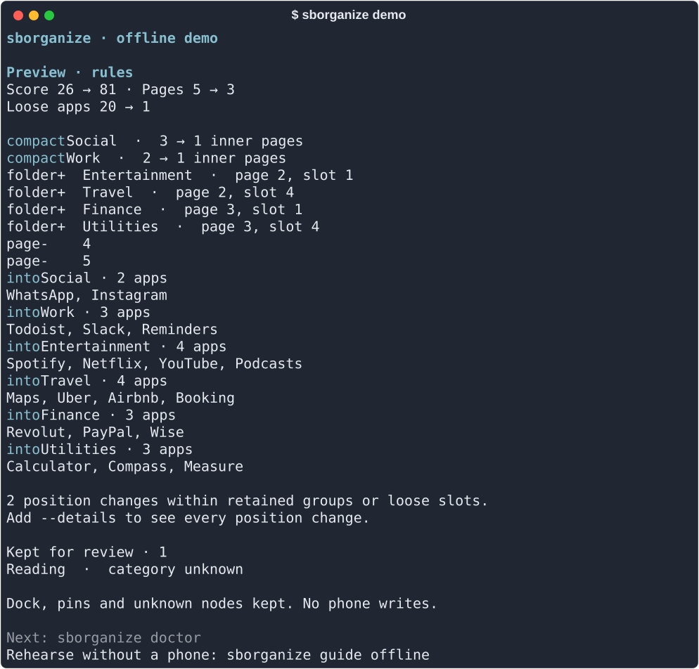

# sborganize

**A calmer iPhone Home Screen. From your terminal.**

[中文指南](README.zh-CN.md) · [Quick start](docs/QUICKSTART.md) · [Commands](docs/CLI.md) · [Safety](docs/SAFETY.md) · [Privacy](PRIVACY.md)

[](https://github.com/tangfy97/sborganize/actions/workflows/ci.yml)
[](LICENSE)

Organize apps into useful folders, preview every change, and keep an exact undo
backup. Local rules work without a model, account, credits or network connection.
Optional Apple inference and explicitly opted-in OpenRouter advice are separate.



## Install

Python **3.11+**. A Mac is the supported starting point for trusted USB access.
The demo, fixtures and local inspection also run on Linux.

With [pipx](https://pipx.pypa.io/latest/how-to/install-pipx.html):

```sh
pipx install 'sborganize[device] @ git+https://github.com/tangfy97/sborganize.git@v0.1.0a10'
sborganize demo
```

Or install from a checkout:

```sh
git clone https://github.com/tangfy97/sborganize.git
cd sborganize
python3 -m venv .venv
source .venv/bin/activate
python -m pip install '.[device]'
sborganize demo
```

This alpha is distributed through GitHub, not PyPI. The `[device]` extra installs
our pinned pymobiledevice3 adapter. Omit it for demo/fixture-only use.

## From a cluttered screen to a reviewed plan

Connect by USB, unlock the iPhone, and choose **Trust This Computer**.

```sh
sborganize doctor
sborganize scan
sborganize plan --existing-only --device-ready
sborganize show --after
```

Nothing has changed on the phone. `--existing-only` groups loose apps while
retaining existing folders and already grouped apps. `--device-ready` prepares a
USB-compatible target and exposes any position shifts.

A default preview shows grouping changes together, rather than hundreds of slot
coordinates. Use `sborganize show --details` for every position change.

When the preview is right:

```sh
sborganize apply --experimental-write
```

The command selects the latest plan, backs up and verifies the current source,
asks for confirmation, verifies an unchanged round-trip, then writes and reads
back the target. The default answer is **No**. Declining makes zero writes.
Keep the phone unlocked and avoid rearranging it during the operation.

**Live writes are experimental.** iOS can normalize or reflow layouts. One
development phone has completed this workflow; this is not a broad compatibility
claim. Hardware restore is not yet validated. Read [safety and recovery](docs/SAFETY.md).

## Useful commands

```sh
sborganize                    # a short starting point
sborganize guide              # the workflow, inside your terminal
sborganize guide offline      # rehearse apply and restore without a phone
sborganize config init        # create a documented local config; never overwrite
sborganize config path        # find it
sborganize backups            # find recent local backups, without USB
sborganize show --after       # inspect the selected plan's complete target
sborganize show --json        # machine-readable plan, without another device read
```

Terminal output uses restrained color, readable spacing and meaningful next
steps. Piped output stays plain. `--no-color` and `NO_COLOR` are supported; JSON
contains no decoration. Run `sborganize --install-completion` for shell completion.
Global options such as `--data-dir` and `--config` go **before** the command.

## Your categories, not a model's guesses

Remember exact app categories, folder maps and pins in local TOML. A bank and a
billing service can share a financial domain across regions, while local shopping
and government services retain regional folders. Developer origin and language
never establish service region. See [classification](docs/CLASSIFICATION.md).

For a deliberate all-app redesign:

```sh
sborganize policy export
sborganize guide policy
```

The export fills in every app name/ID and current membership. Edit the draft to
choose emoji folder names, destinations and reasons. A policy can explicitly
rename and reorder existing editable folders, keep chosen groups adjacent, and
fill each folder page before starting another. Every app must be accounted for.
The full workflow and synthetic example are in [the policy guide](docs/POLICY.md).

For optional model advice, run `sborganize guide cloud`. Rules require no credits.
Cloud review is advisory: a valid response is not proof of a correct category.
No cloud request happens because a key exists, or because Apple is unavailable.

## What stays protected

- The dock, configured pins, app inventory and unknown widget nodes.
- Your exact local source backup and an explicit confirmation before writes.
- Your data: no telemetry, app-container access, photos, messages or health records.

Raw plans, backups, policies and reviews can reveal installed apps. They stay in
`~/.sborganize/` by default; do not attach them to public issues. Cloud metadata
sharing needs an explicit flag and is described in [PRIVACY.md](PRIVACY.md).

## Guides and contributing

[Quick start](docs/QUICKSTART.md) · [CLI reference](docs/CLI.md) ·
[Classification](docs/CLASSIFICATION.md) · [Policies](docs/POLICY.md) ·
[Troubleshooting](docs/TROUBLESHOOTING.md) · [Support matrix](docs/COMPATIBILITY.md)

```sh
python -m pip install -e '.[dev]'
pytest
ruff check .
ruff format --check .
python -m build
```

Tests use synthetic fixtures and fake devices, not a contributor's phone.
See [CONTRIBUTING.md](CONTRIBUTING.md), [development](docs/DEVELOPMENT.md) and
[security reporting](SECURITY.md).

[GPL-3.0-or-later](LICENSE). Direct device I/O is owned here through
[pymobiledevice3](https://github.com/doronz88/pymobiledevice3); this is not an Unjiggle wrapper.
