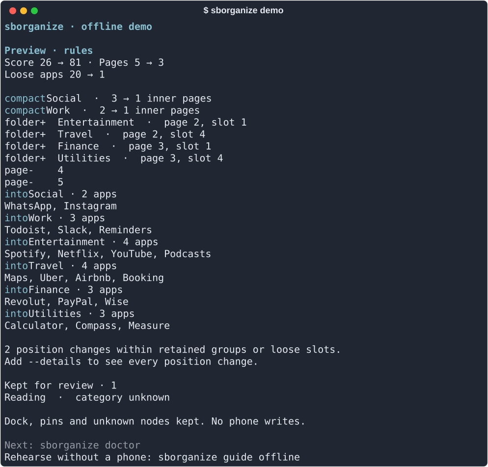

# sborganize

**在终端里，把 iPhone 主屏整理得更清楚。**

[English](README.md) · [快速上手](docs/QUICKSTART.md) · [命令参考](docs/CLI.md) · [安全与恢复](docs/SAFETY.md) · [隐私说明](PRIVACY.md)

按领域分类，先看预览，确认后才写入。默认使用离线规则：**不需要模型、账号或额度**。
支持自己的 emoji 分组、银行与账单分组、地面交通与航空旅行分组，以及文件夹内页依次填满。



## 安装

需要 Python 3.11+。iPhone USB 整理以 Mac 为起点；Linux 也可以运行演示和离线测试。

已经安装 [pipx](https://pipx.pypa.io/latest/how-to/install-pipx.html) 时：

```sh
pipx install 'sborganize[device] @ git+https://github.com/tangfy97/sborganize.git@v0.1.0a10'
sborganize demo
```

或者从源码安装：

```sh
git clone https://github.com/tangfy97/sborganize.git
cd sborganize
python3 -m venv .venv
source .venv/bin/activate
python -m pip install '.[device]'
sborganize demo
```

当前通过 GitHub 发布 alpha 版本，尚未发布到 PyPI。只体验离线演示时可以不安装 `[device]`。

## 第一次使用

用 USB 连接 iPhone，保持解锁，并在手机上选择信任这台电脑。

```sh
sborganize doctor
sborganize scan
sborganize plan --existing-only --device-ready
sborganize show --after
```

到这里，手机没有发生任何改变。

- `plan`：生成并保存方案。
- `show --after`：看整理后的完整布局，无需再次连接手机。
- `show --details`：展开每一项位置变化。
- `--existing-only`：只把散落 App 归入已有组，保留已分组 App 的位置。

确认预览后：

```sh
sborganize apply --experimental-write
```

程序会重新核对布局、保存并校验备份，再询问确认。通过原样回写校验后，才会写入目标布局并读回核验。
默认回答为 No；拒绝时不会写入。执行期间请保持手机解锁，暂时不要手动调整主屏。

**真机写入仍为实验性功能。** 已在一台开发用 iPhone 上完成整理，但尚没有完整的 iOS 支持矩阵，真机恢复也未验证。
请先阅读[安全与恢复指南](docs/SAFETY.md)。

## 常用入口

```sh
sborganize guide              # 在终端内看完整入门流程
sborganize guide offline      # 没有手机也能演练 apply / restore
sborganize config init        # 生成带注释的配置，不覆盖已有文件
sborganize config path        # 找到配置文件
sborganize backups            # 列出本地备份，不需要连接手机
sborganize policy export      # 导出逐个 App 可编辑的分类草稿
sborganize guide policy       # emoji、分组排序和填满内页的操作指南
```

高级分类策略需要逐个确认 App 的用途和去向，不能把模型的建议直接当成事实。
银行、账单、AI、娱乐、学习/网盘等规则可以保存在本机，后续不必反复请求模型。
默认中国大陆/香港地区分组按服务地区判断，不按开发商国别或 App 名称语言判断。

终端支持克制的颜色和清晰的分组输出；重定向时保持纯文本。`--no-color`、`NO_COLOR` 和 `--json` 适合脚本使用。
`--data-dir`、`--config` 等全局参数放在子命令前。

## 可选模型

```sh
sborganize guide cloud
```

`--cloud` 才会使用 OpenRouter，自备 key，在终端隐藏输入。规则模式不会因为环境中有 key 或本地模型失败而自动转云端。
`--smart` 是单独的 Apple 本机模型路径，不可用时保留规则结果；不使用 Ollama。

没有额度时，仍可以使用离线规则、配置、已有审查结果和显式分类策略。

## 数据与备份

默认数据目录是 `~/.sborganize/`。方案、备份、分类策略和审查报告可能暴露安装的 App，请不要上传到公开 issue。
程序不读取照片、消息、联系人、健康记录或 App 容器内容，不卸载 App，也没有遥测。

[隐私说明](PRIVACY.md) · [命令参考](docs/CLI.md) · [分类规则](docs/CLASSIFICATION.md) · [故障排查](docs/TROUBLESHOOTING.md)

项目使用 [GPL-3.0-or-later](LICENSE)，设备读写直接由自身的 pymobiledevice3 适配器完成。
